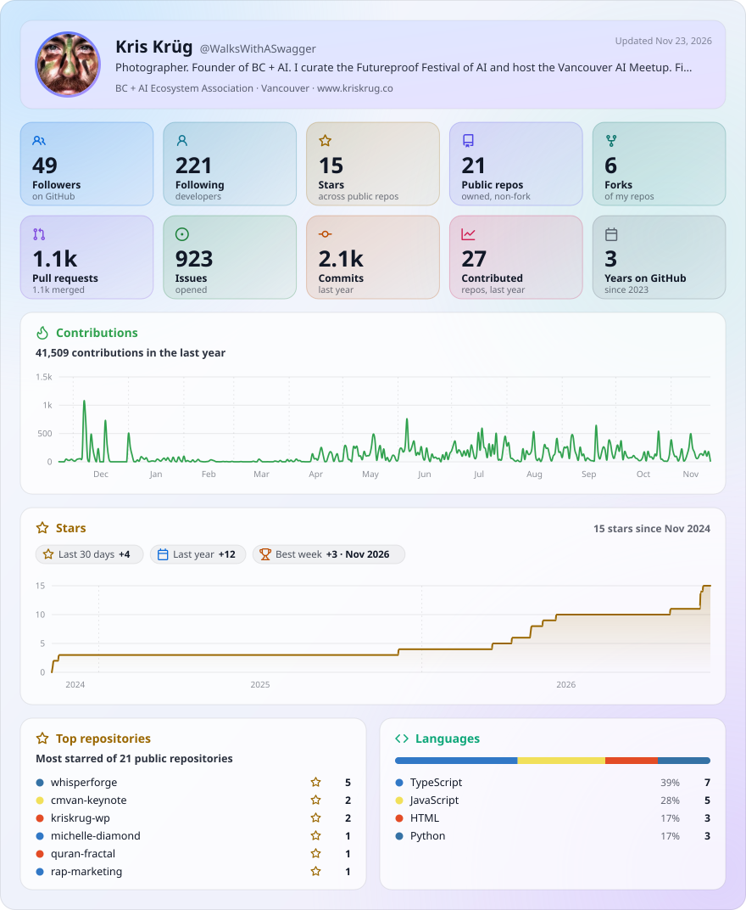

# Hey, I’m Kris Krüg.

Most people call me KK. I’m a photographer, educator, and community builder in Vancouver. I got my start on the web building Drupal sites with friends at Bryght. These days I’m interested in who gets a say in how AI changes the places we live and the things we make.

* **[Futureproof Festival of AI](https://www.futureproof.website/)** is the festival I curate in Vancouver. In 2026, Brewster Kahle joined us from the Internet Archive, and Philippe Pasquier played live AI music at the planetarium. [Explore the program](https://www.futureproof.website/program/).
* **[BC + AI Ecosystem Association](https://bc-ai.ca/)** is the nonprofit I founded and lead. We run a film club, an animation accelerator, and a Responsible AI Professional program for people making decisions they’ll have to answer for.
* **[Vancouver AI Meetup](https://bc-ai.ca/communities/vancouver-ai)** is where you can actually find me. I host it every month. Come show us what you’re making, especially if it’s still a little busted.
* **[kriskrug.co](https://kriskrug.co/)** is my home on the web. Start with [the photographs](https://kriskrug.co/photography/) if you want to see what I’ve been pointing a camera at all these years.

Find me on Bluesky at [@kriskrug.co](https://bsky.app/profile/kriskrug.co).

<picture>
  <source media="(prefers-color-scheme: dark)" srcset="glancecard/profile-dark.svg">
  
</picture>
